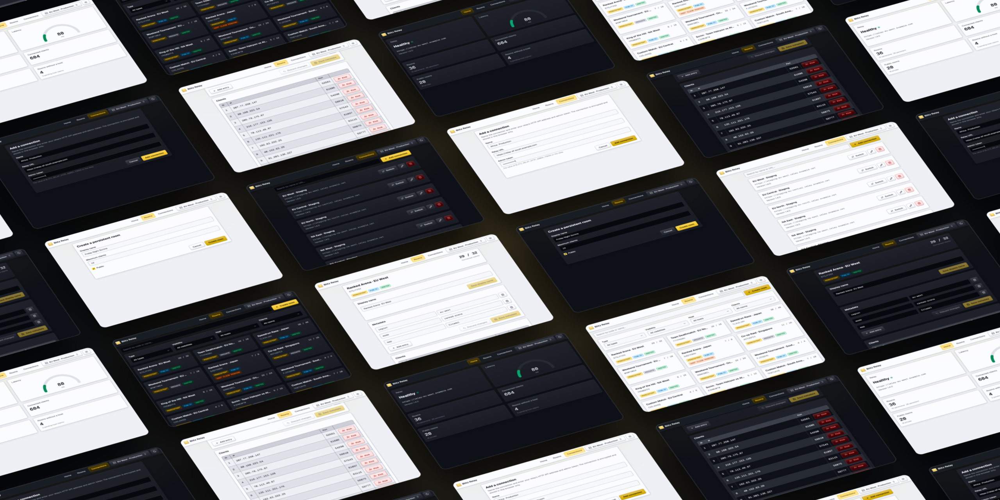

# Blitz Relay Dashboard



A web dashboard for monitoring and managing [Blitz Relay](https://github.com/abdelfattahradwan/blitz-relay) servers
through their HTTP admin API. It runs entirely in the browser, so any static web server can host it.

## Features

- **Overview**: the relay's health, version, latency, and room statistics, updated live.
- **Rooms**: every room on the relay, with search and filters for type, visibility, host, and clients.
- **Room management**: create persistent rooms, rename and delete rooms, edit their metadata, and remove their hosts.
- **Clients**: each room's clients, with their IP addresses when the relay reveals them, and a kick button for each.
- **Connections**: save several relays and switch between them from the navigation bar.
- **Themes**: dark, light, or the system preference.
- **Encrypted storage**: connections, including their admin tokens, are encrypted and stored only in the browser.

## Requirements

- A Blitz Relay server with its HTTP API enabled. Any version works, but versions 1.4.0 and later offer API improvements
  that the dashboard takes full advantage of.
- Docker, or a web server such as nginx, Apache HTTP Server, or Caddy.
- A current version of a major browser.

## Run the dashboard with Docker

The `Dockerfile` builds the dashboard and serves it with [static-web-server](https://static-web-server.net/). The image
contains only the web server and the dashboard's files.

1. Build the image:

   ```sh
   docker build -t blitz-relay-dashboard .
   ```

2. Start a container:

   ```sh
   docker run -d -p 8080:8080 --read-only --cap-drop ALL --name blitz-relay-dashboard blitz-relay-dashboard
   ```

   Or start it with Docker Compose, which applies the same restrictions:

   ```sh
   docker compose up -d
   ```

3. Open http://localhost:8080.

The container:

- Listens on port `8080` and runs as an unprivileged user.
- Serves `index.html` for any path that doesn't match a file.
- Sends an `X-Robots-Tag: noindex, nofollow` header with every response.
- Revalidates `index.html` on every visit and caches the hashed files in `/_app/immutable/` for a year.
- Answers health checks at `/health`. The image has no shell or `curl`, so probe it from your orchestrator or reverse
  proxy rather than with a Docker `HEALTHCHECK`.
- Serves HTTP only. For HTTPS, run it behind a reverse proxy.

To build the image for `linux/amd64` and `linux/arm64` and push it to your registry, use Docker Buildx:

```sh
docker buildx build --platform linux/amd64,linux/arm64 -t REGISTRY/blitz-relay-dashboard --push .
```

Replace `REGISTRY` with your registry's address, for example `ghcr.io/your-name`.

## Deploy the dashboard

The commands in this document use [Bun](https://bun.sh), but any package manager works. For more information, see
[Use another package manager](#use-another-package-manager).

1. Install the dependencies:

   ```sh
   bun install
   ```

2. Build the static site into the `build` directory:

   ```sh
   bun run build
   ```

3. Copy the contents of the `build` directory to your web server.
4. Configure the web server to serve `index.html` for any path that doesn't match a file, so that links such as
   `/rooms/ABCD1234` work when they're opened directly or reloaded.

The following configurations serve the dashboard at `dashboard.example.com` from `/srv/blitz-relay-dashboard`, and send
an `X-Robots-Tag` header that stops search engines from indexing it. The nginx and Apache HTTP Server configurations
serve HTTP; add your certificate configuration for HTTPS. Caddy serves HTTPS automatically.

### nginx

Add the following `server` block to your nginx configuration:

```nginx
server {
    listen 80;
    server_name dashboard.example.com;
    root /srv/blitz-relay-dashboard;

    add_header X-Robots-Tag "noindex, nofollow" always;

    location / {
        try_files $uri /index.html;
    }
}
```

**Note**: If you add an `add_header` directive to `location /`, repeat the `X-Robots-Tag` header there. A `location`
block with its own `add_header` directives doesn't inherit those of the `server` block.

### Apache HTTP Server

Enable the `mod_dir` and `mod_headers` modules, and then add the following virtual host to your configuration:

```apache
<VirtualHost *:80>
    ServerName dashboard.example.com
    DocumentRoot "/srv/blitz-relay-dashboard"

    <Directory "/srv/blitz-relay-dashboard">
        Require all granted
        FallbackResource /index.html
    </Directory>

    Header always set X-Robots-Tag "noindex, nofollow"
</VirtualHost>
```

### Caddy

Add the following site block to your Caddyfile:

```caddyfile
dashboard.example.com {
    root /srv/blitz-relay-dashboard
    encode
    header X-Robots-Tag "noindex, nofollow"
    try_files {path} /index.html
    file_server
}
```

## Connect to a relay

The dashboard calls the relay's HTTP API directly from the browser, so the API must be reachable from every device that
opens the dashboard. Configure the relay first:

- Don't start it with the `--disable-http` flag. The HTTP API listens on port `7771` by default.
- Set the admin token in the `BLITZ_RELAY_HTTP_ADMIN_TOKEN` environment variable.
- If you restrict cross-origin resource sharing (CORS) with the `--cors` flag, add the dashboard's origin to
  `allowedOrigins`, and allow the `Authorization` and `Content-Type` headers and the `GET`, `POST`, `PATCH`, and
  `DELETE` methods. By default, the relay accepts requests from any origin.
- If you serve the dashboard over HTTPS, serve the relay's HTTP API over HTTPS too. Browsers block requests from HTTPS
  pages to HTTP addresses.
- To show clients' IP addresses, set the `--client-details` option to `IpAddresses`, or to `IpEndpoints` to include
  ports. By default, the relay reveals only client IDs.

To add a connection:

1. Open the dashboard. The first time, the **Add a connection** page opens. Later, click **Connections** in the
   navigation bar, and then click **Add connection**.
2. In **Name**, enter a name for the relay, for example `Production`.
3. In **Relay URL**, enter the address of the relay's HTTP API, for example `http://localhost:7771`.
4. In **Admin token**, enter the value of `BLITZ_RELAY_HTTP_ADMIN_TOKEN`.
5. Click **Add connection**.

The dashboard checks that the relay responds, saves the connection, and makes it active. To switch relays, click the
active connection's name in the navigation bar and choose another connection. To edit or delete connections, use the
**Connections** page.

## Security

The dashboard encrypts saved connections with AES-GCM under a non-extractable key and stores them in the browser's
IndexedDB. This keeps admin tokens out of plain-text storage, but anyone with access to the browser profile can still
use them. Restrict access to the browser profile and to the web server that hosts the dashboard.

## Develop the dashboard

Install the dependencies and start the development server:

```sh
bun install
bun run dev
```

The project has the following scripts:

| Command           | Description                                        |
| ----------------- | -------------------------------------------------- |
| `bun run dev`     | Starts the development server                      |
| `bun run check`   | Type-checks the project with `svelte-check`        |
| `bun run lint`    | Checks formatting with oxfmt and lints with ESLint |
| `bun run format`  | Formats the project with oxfmt                     |
| `bun run build`   | Builds the static site into the `build` directory  |
| `bun run preview` | Serves the production build locally                |

## Use another package manager

The project doesn't depend on Bun. You can use npm, pnpm, aube, or Nub instead:

- [aube](https://aube.sh) and [Nub](https://nubjs.com) use the existing `bun.lock` file as it is.
- npm and pnpm create their own lockfiles, so delete `bun.lock` before you install the dependencies with them.

To run a script, replace `bun run` with your package manager's equivalent, for example `npm run build`.

## Licence

Blitz Relay Dashboard is released under the MIT License. For more information, see the [`LICENSE`](LICENSE) file.
